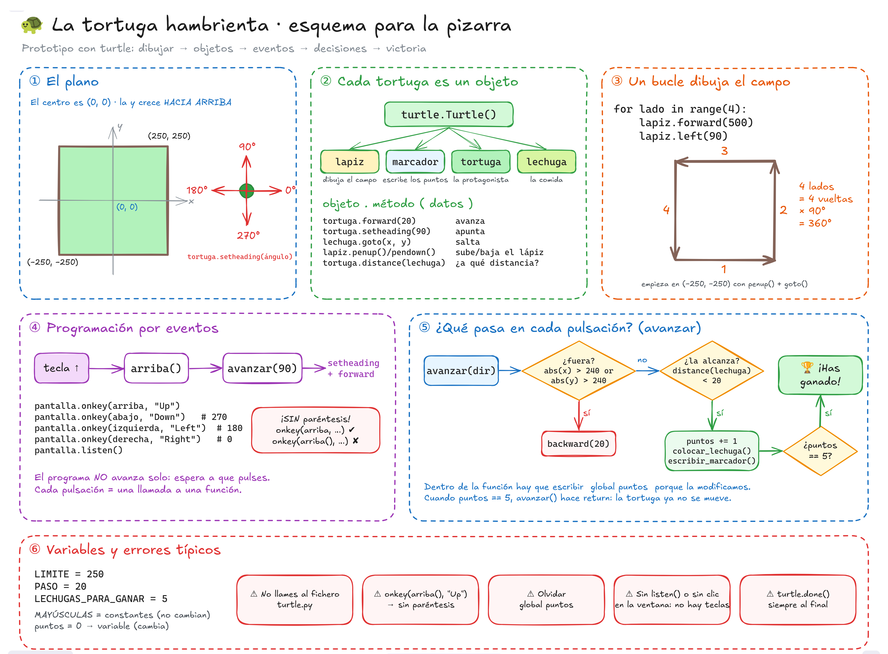

# Actividades de iniciación a la programación · 1.º DAW

Material para el módulo de Programación (0485) de 1.º de DAW (FP), con Python. Cada actividad incluye un notebook ya ejecutado que explica la solución fase a fase y que se puede abrir directamente en Google Colab.

| Actividad | Librería | Nivel | Notebook |
|---|---|---|---|
| 🐢 [La tortuga hambrienta](tortuga-hambrienta/) | `turtle` | Muy básico | [](https://colab.research.google.com/github/maximofernandezriera/atrapa-la-estrella/blob/main/tortuga-hambrienta/tortuga_hambrienta_solucion_explicada.ipynb) |
| ⭐ Atrapa la estrella | Pygame Zero | Básico | [](https://colab.research.google.com/github/maximofernandezriera/atrapa-la-estrella/blob/main/atrapa_la_estrella_solucion_explicada.ipynb) |

Como Colab no puede abrir ventanas, los notebooks simulan la pantalla (de `turtle` o de Pygame Zero). Al final de cada uno se puede descargar el programa para ejecutarlo en local.

## 🐢 La tortuga hambrienta

Carpeta [`tortuga-hambrienta/`](tortuga-hambrienta/):

- `enunciado_tortuga.pdf`: enunciado para el alumnado.
- `plantilla_tortuga.py`: código de partida.
- `solucion_tortuga.py`: solución de referencia.
- `tortuga_hambrienta_solucion_explicada.ipynb`: solución explicada.
- `fuente_latex_tortuga.zip`: fuente LaTeX del enunciado (compilar con `pdflatex` dos veces).
- `tortuga_hambrienta_pizarra.png` / `.excalidraw`: esquema para la pizarra (el `.excalidraw` se edita en [excalidraw.com](https://excalidraw.com)).



```
python tortuga.py        # turtle viene incluido con Python
```

## ⭐ Atrapa la estrella

```
pip install pgzero
python estrella.py
```
